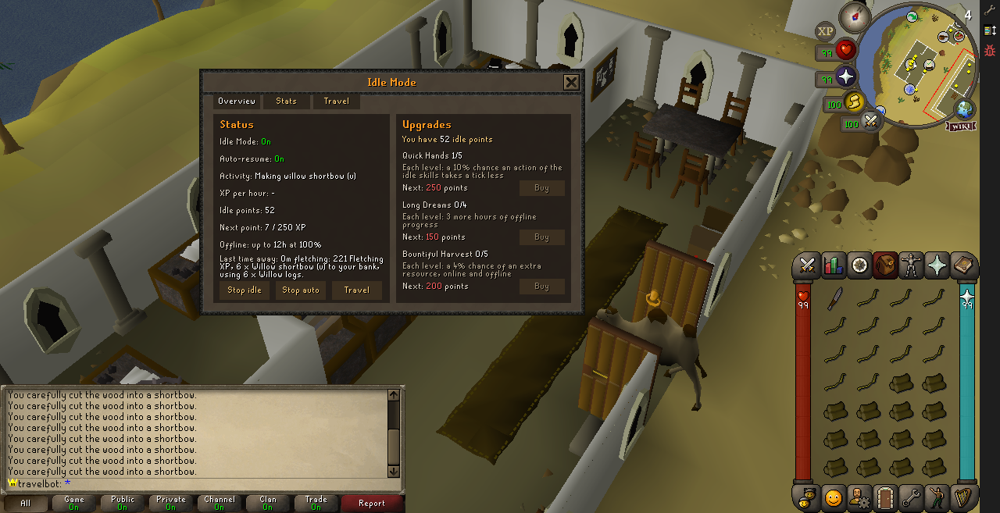
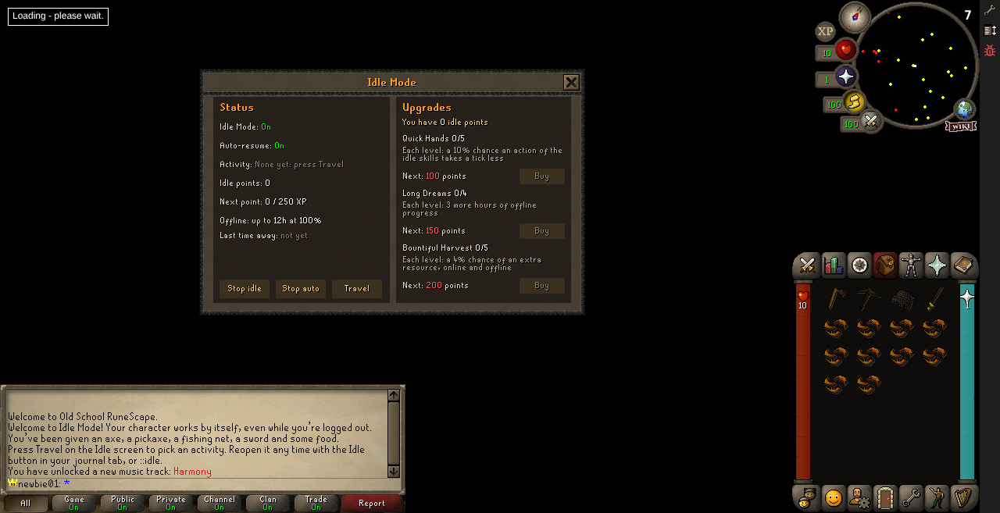
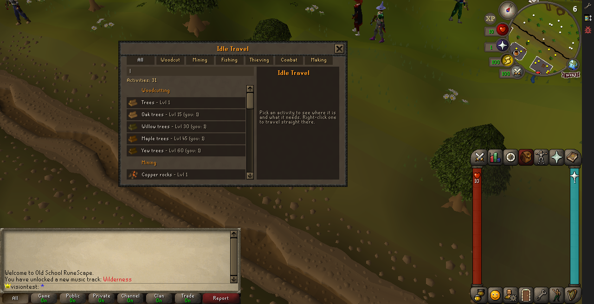

# Jogo idle (fork do tsps)

Este fork transforma o tsps num jogo idle de OSRS, mantendo o mundo 3D e as contas online.
Tudo é um plugin, o **IdleMode**, que liga um "modo idle" por conta, do mesmo jeito que o
Ironman. A documentação técnica completa (em inglês, como o resto do projeto) está em
[`docs/idle-mode.md`](docs/idle-mode.md).

## Como rodar

```bash
npm run setup
```

```bash
yarn start
```

Abra http://localhost:3000. O cache do jogo é baixado de `archive.openrs2.org` na primeira vez.

## Mundo idle (todas as contas novas já começam idle)

Crie `server/data/definitions/world.local.json` (ele não entra no git) com:

```json
{
  "pluginConfig": { "IdleMode:newAccounts": true }
}
```

Sem isso, cada jogador liga o modo com `::idle on`.

## Comandos no jogo

| Comando | O que faz |
| --- | --- |
| botão **Idle** na aba do diário | Abre a tela do modo idle, sem digitar nada |
| `::idle` | Abre a tela do modo idle, com abas: Overview (status, pontos, melhorias), Stats (XP por skill, itens, tempo idle), Goals (metas do dia), Feats (conquistas) e Travel |
| `::idle status` | Diz no chat se o modo idle está ligado |
| `::idle on` / `::idle off` | Liga ou desliga o modo idle da conta |
| `::idle auto` | Mostra o que o personagem vai retomar sozinho |
| `::idle auto on` / `::idle auto off` | Liga ou desliga a retomada automática |
| `::idle travel` | Abre a tela de viagem: escolha uma atividade e o personagem vai até lá |
| `::idle go <local>` | Viaja direto pra um local (ex.: `draynor-willows`, `lumbridge-cows`) |
| `::idle sites` | Lista os locais disponíveis |
| `::idle points` | Mostra seus pontos idle |
| `::idle shop` | Lista as melhorias, níveis e preços |
| `::idle buy <melhoria>` | Compra o próximo nível (`quick-hands`, `long-dreams`, `bountiful-harvest`) |



## Primeiro login

Na primeira vez que uma conta fica idle (conta nova num mundo idle, ou o primeiro `::idle on`):

- recebe o **kit inicial**: machado, picareta, rede de pesca, espada e 10 camarões;
- conta nova num mundo idle começa no **pátio do castelo de Lumbridge**, longe da Wilderness;
- aparecem **3 linhas de boas-vindas** no chat e a **tela idle abre sozinha**;
- depois disso, a tela abre pelo botão **Idle** na aba do diário (o ícone de missões);
- a mesma aba mostra no topo a seção **Idle Information**: atividade, XP por hora, pontos e tempo
  idle;
- sempre que você volta e o jogo pagou tempo offline, a tela idle abre sozinha com o resumo.



## O que o modo idle faz

1. **Coleta infinita** (Woodcutting, Mining, Fishing): tudo vai direto pro banco, árvores e
   pedras não se esgotam, os pontos de pesca não mudam de lugar, não há random events e o pop-up
   de level-up não interrompe.
2. **Progresso offline**: ao sair no meio de uma atividade, o servidor guarda a taxa real que você
   tinha (itens e XP por hora). Ao voltar, paga o tempo fora (até 12h, mais com melhorias) e mostra
   o resumo "While you were away...".
3. **Retomada automática**: o último recurso em que você trabalhou vira o alvo. Quando a coleta
   para, o personagem anda até o mais próximo do mesmo tipo e recomeça.
4. **Pontos e melhorias**: 1 ponto a cada 250 XP idle. As melhorias são Quick Hands
   (ações mais rápidas), Long Dreams (mais horas offline) e Bountiful Harvest (recursos extras).
5. **Combate idle**: ataque e mate um monstro, e o personagem continua atacando os do mesmo tipo
   por perto. Ele come quando a vida fica abaixo de 50%, revida quando é atacado e manda os drops
   pro banco. Também conta para o progresso offline.
6. **Produção idle** (Cooking, Smithing, Fletching, Crafting, Herblore, Firemaking): faça uma vez
   à mão (cru no fogão, faca no tronco, minério na fornalha) e escolha o produto. O personagem
   continua sozinho: guarda os produtos no banco, pega mais material do banco e repete, até o
   material acabar. Offline, gasta o material do banco no mesmo ritmo.
   - **Firemaking**: tinderbox nas toras faz uma linha de fogueiras; ao se afastar 12 tiles do
     início, ele volta para um tile livre e recomeça. Toras numa fogueira alimentam a fogueira;
     quando ela apaga (uma pessoa sozinha não a mantém acesa), ele acende outra com a tinderbox.
7. **Thieving idle**: bata carteira (Pickpocket) ou roube de uma barraca (Steal-from) uma vez e o
   personagem continua sozinho. O saque vai pro banco (moedas direto, sem coin pouch), as barracas
   não se esvaziam e nenhum guarda pega um ladrão idle (os de Ardougne matariam um personagem
   sozinho). Ao bater carteira ele come quando a vida cai abaixo de 50%.
8. **Viagem até a atividade**: na tela `::idle travel` (ou no botão Travel da tela idle), escolha
   entre 31 locais (árvores, minas, pesca, thieving, monstros e, na aba Making, fogões, fornalhas,
   um banco pra produção e o Grand Exchange pra firemaking, de Lumbridge a Karamja). O personagem
   teleporta e já começa a trabalhar sozinho. Locais de coleta pedem o nível da skill.



O que falta para o jogo ficar jogável está em [`IDLE_ROADMAP.md`](IDLE_ROADMAP.md).

Todos os números (velocidades, limites, preços) ficam em
`server/plugins/modes/data/idle-mode.json`.

## Testes

```bash
cd server && node --test tests/idle-mode.test.cjs
```

O teste dos locais de viagem usa o cache do jogo (baixado no primeiro `yarn start`):

```bash
cd server && node --test tests/idle-travel-sites.test.cjs
```

## Atualizar com o projeto original

```bash
git fetch upstream && git merge upstream/main
```

O código idle fica em arquivos próprios (`server/plugins/modes/idle/`). Do projeto original, só
poucos pontos foram mexidos, todos pequenos: `Fishing.plugin.js` ganhou um evento
(`fishing:spot-stays`), `SkillLevelUp.plugin.js` passou a ler um atributo do jogador
(`level-up:keep-actions`), o diário lateral (`sidejournaldefaults/Layout.SideJournalDefaults.js`)
ganhou o botão Idle (botões um pouco mais estreitos, e o teste `character-summary` com a posição
nova) e a seção Idle Information, o `api.core` ganhou o `UseItemPacketListener` (em
`PluginManager.ts` e `PluginTypes.ts`), e `docs/world-configuration.md` ganhou uma seção. Assim os merges com o
upstream ficam simples.
