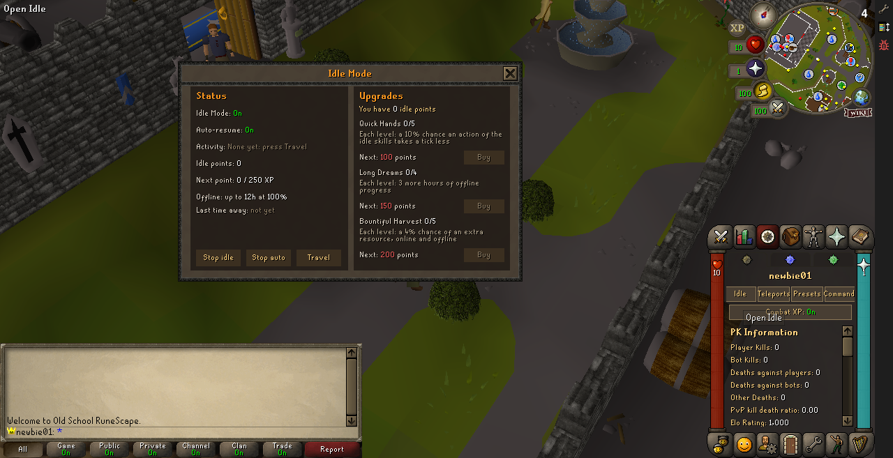
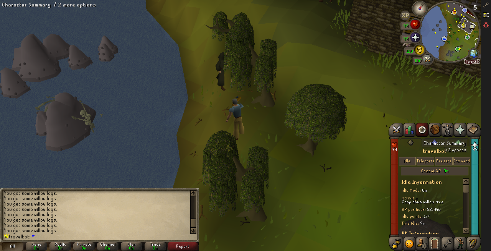
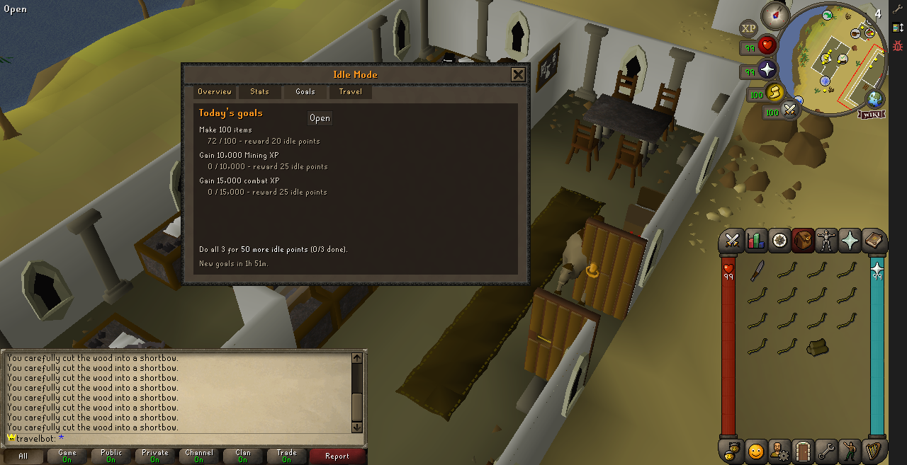
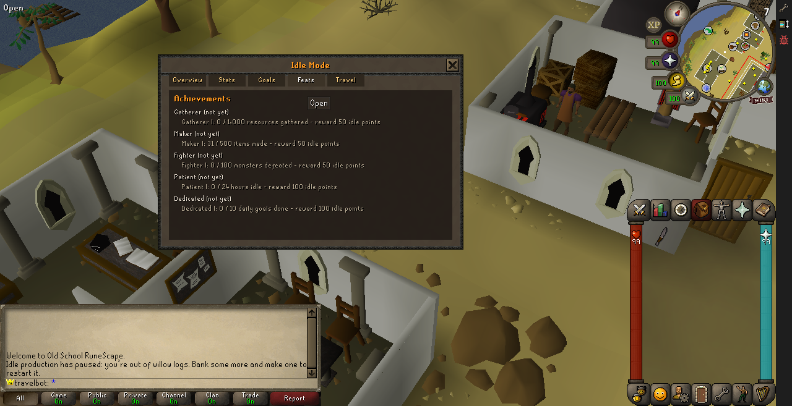
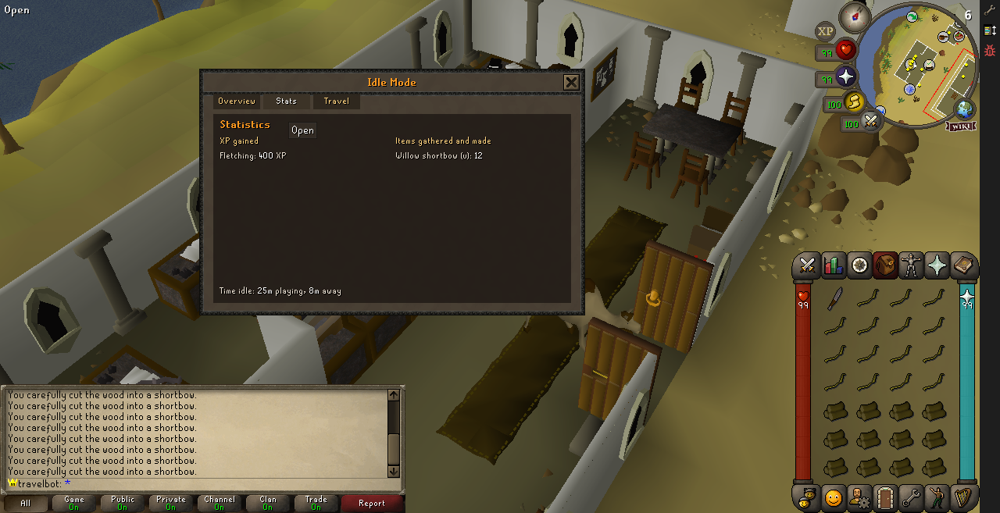
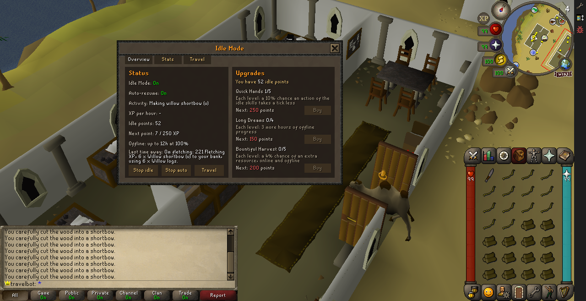
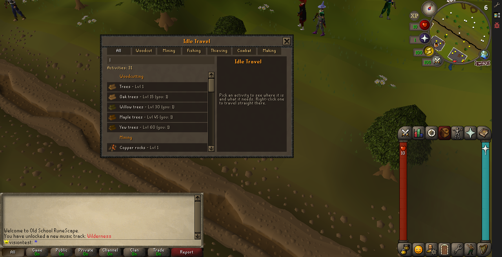
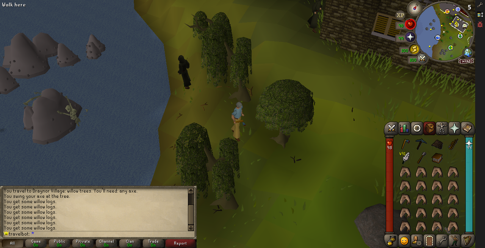

# Idle Mode

Idle Mode is this fork's idle game, built as an **account flag** on the normal game, the same way
Ironman is. An idle account keeps gathering by itself, in the 3D world, and keeps gathering while
it is logged out.

- **Plugin:** `server/plugins/modes/IdleMode.plugin.js`, with one unit per feature in `server/plugins/modes/idle/`.
- **Data:** `server/plugins/modes/data/idle-mode.json`.
- **Tests:** `server/tests/idle-mode.test.cjs` (no cache needed).

None of this is OSRS behaviour: it is all ours.

## Turning it on

**In game**, any player:

```
::idle          open the Idle screen
::idle status   say whether Idle Mode is on
::idle on       turn it on
::idle off      turn it off
```

It's saved as the attribute `idle-mode:enabled` (off by default).

**An idle world** makes every new account idle. Set it in `world.json` or, for one deployment,
`world.local.json` ([World configuration](world-configuration.md)):

```json
{
  "pluginConfig": { "IdleMode:newAccounts": true }
}
```

## Endless gathering

For an idle account, Woodcutting, Mining, Fishing and Thieving (`"skills"` in the data) never
stop (`server/plugins/modes/idle/Gathering.IdleMode.js`, and `Thieving.IdleMode.js` for what is
Thieving's own, [below](#idle-thieving)):

| Setting (`"gathering"`) | What it does | Event it answers |
| --- | --- | --- |
| `bankResources` | What is gathered goes straight to the bank. The bank's room counts as room, so a full inventory does not stop the gathering. What an open container (a log basket, a coal bag) took stays there. A full bank gathers into the inventory as usual. | `storage:gather`, `storage:room` |
| `endlessResources` | Trees and rocks do not deplete. | `woodcutting:deplete-tree`, `mining:deplete-rock` |
| `fishingSpotsStay` | A fishing spot's random stop is skipped. Spots with their own movement (the minnow platform) still move. | `fishing:spot-stays` (emitted by `Fishing.plugin.js`) |
| `randomEvents` | `false` keeps random events away from idle accounts. | `random-events:eligibility` |
| `levelUpPopups` | `false`: an idle account's level-up pop-up does not open and hold the work until Continue (the message, graphic and sounds stay). | the attribute `level-up:keep-actions`, read by `SkillLevelUp.plugin.js`; set with the account flag and on every login |

## Idle thieving

`server/plugins/modes/idle/Thieving.IdleMode.js`, settings in `"thieving"`. Thieving is one of the
idle `"skills"`, so a stall's theft is a gather like a log (the stall's `storage:gather`, which now
carries `skill: THIEVING` and the stall's XP): it goes to the bank, counts for the offline
progress, auto-resume, goals and Bountiful Harvest. Pickpockets and stalls come back by
auto-resume like a tree, from the click (an NPC's Pickpocket, a stall's Steal-from).

| Setting (`"thieving"`) | What it does | Event it answers |
| --- | --- | --- |
| `bankLoot` | A pickpocket's loot goes to the bank, each item as a Thieving gather. Coins go straight in, with no coin pouch to open (so no rogue outfit doubling); clues stay in the inventory. | `thieving:loot` |
| `keepStalls` | A stall stays stocked. | `thieving:deplete-stall` |
| `unseenAtStalls` | No owner or guard catches an idle thief at a stall. A character left alone would be attacked by guards it can't run from: East Ardougne's killed a level-5 test character in seconds. | `thieving:stall-watch` |
| `repeat` | With auto-resume on, a theft that worked is followed by the next a tick later, while the player stays put (the Larcenist relic's way). A failed pickpocket stuns; auto-resume picks it up after the stun, and the stun counts as work, not as a try that went nowhere. | `thieving:done` |
| `eatBelowPercent` / `stopBelowPercent` | A failed pickpocket hurts: before each one auto-resume eats the first food below `50`% hitpoints, and below `25`% with no food waits to heal, said once. | (auto-resume) |

Checked in game: Lumbridge's men from Thieving level 1 to 5 (eating shrimps), Varrock's tea stall
and East Ardougne's baker's stall to level 12, the loot in the bank.

## Offline progress

`server/plugins/modes/idle/Offline.IdleMode.js`. While an idle account works, the plugin
measures the rate it really gets from its own results: each idle gather (`storage:gather`) and
each idle kill (Combat) records the items and the activity's skills' XP. Nothing is estimated
from formulas, so tools, levels, boosts and relics all count as they did in play.

- **A session** starts on the first result. Another activity (another gathering skill, or
  combat), or more than `maxGapSeconds` between two results, starts a new one (combat has its
  own, longer `maxGapSeconds`: kills come slower than gathers).
- **Logging out** mid-session (the last result no more than `maxGapSeconds` before) with at
  least `minSampleSeconds` measured saves the session as `idle-mode:away`:
  `{ activity, durationMs, xp: { skill: xp }, items, loggedOutAt }`; `activity` is the gathering
  skill (`"WOODCUTTING"`) or `"COMBAT"`.
- **Restarts and crashes**: the server's shutdown saves players without logging them out, so
  `idle-mode:away` is also kept current on every result while playing. Any save carries it: the
  shutdown save, or the last autosave (every 5-10 minutes) before a crash, and the next login pays
  the time away from that save. Checked in game with SIGTERM and with `kill -9`.
- **Logging back in** pays the time away at that rate: the XP to the skills (the world's XP rate
  was already in the measured XP, so it isn't applied twice) and the items to the bank. Time over
  `capHours` isn't paid, and `efficiency` scales the whole reward (`1` = the rate played). What
  the bank has no room for is lost. The player is told:

```
While you were away for 1h 0m, you kept woodcutting:
15,000 Woodcutting XP, 600 x Logs to your bank.
```

| Setting (`"offline"`) | Default |
| --- | --- |
| `enabled` | `true` |
| `minSampleSeconds` | `60` |
| `maxGapSeconds` | `60` |
| `capHours` | `12` |
| `efficiency` | `1` |

## Auto-resume

`server/plugins/modes/idle/Auto.IdleMode.js`. The character goes back to work by itself:

- **The target** is the last object or NPC option an idle player clicked (seen through
  `onBeforeObjectInteraction` / `onBeforeNpcInteraction`) that led to an idle skill's gather
  within `rememberClickSeconds`: its name, the option, and where the player stood (the anchor).
  It's saved as `idle-mode:auto-target` `{ skill, kind, name, option, anchor }`, so it survives
  logging out. Gathering the same kind of thing nearby keeps the anchor; anything else replaces it.
- **Every `tickInterval` ticks**, for each idle player with a target: when nothing has been
  gathered for `restartAfterSeconds` (and nothing was tried for `retrySeconds`), the character
  walks to the nearest object or NPC with that name and option within `searchTiles` of the anchor
  and uses the option, as the player's click would. Nothing in reach (a rock respawning) waits.
- **It leaves the player be** while they are busy (an interface open, a teleport), moving, in
  combat, on another floor, or more than `leashTiles` from the anchor. Walking off to do something
  else pauses it; coming back resumes it.
- **A try that gathers nothing** (a rock out of reach from this side) leaves that one alone for
  `skipSeconds` and tries the next nearest.
- **It pauses** when the player clicks something else (another object or NPC, an attack) until
  their next gather, and after `maxFailedAttempts` tries in a row that gathered nothing (no axe,
  too low a level), which it says once. `::idle auto on` lifts a pause.

```
::idle auto        what it will resume
::idle auto off    stop resuming (saved as idle-mode:auto)
::idle auto on     resume again
```

| Setting (`"auto"`) | Default |
| --- | --- |
| `enabled` | `true` |
| `tickInterval` | `2` |
| `restartAfterSeconds` | `12` |
| `retrySeconds` | `6` |
| `rememberClickSeconds` | `30` |
| `searchTiles` | `16` |
| `leashTiles` | `24` |
| `maxFailedAttempts` | `3` |
| `skipSeconds` | `120` |

## Idle production

`server/plugins/modes/idle/Production.IdleMode.js`, settings in `"production"`. Cooking,
Smithing, Fletching, Crafting, Herblore and Firemaking, through the skills' own flows, so no recipe
is duplicated here:

- **The target**: the last thing an idle player did by hand that made something
  (`skills:produced`, one of `"skills"`) within `rememberClickSeconds`: an item used on an object
  (raw food on a range, ore on a furnace), an item used on another (a knife on logs) or an
  object's option (Smelt at a furnace), seen through `onItemOnObject`, `onItemOnItem` and
  `onBeforeObjectInteraction`. With it: the product, where the player stood, and the **loadout**,
  the inventory as it was (materials and tools). Saved as `idle-mode:production-target`. One
  activity at a time (`Common.setActivity`): making something replaces the gathering or combat
  target, and they replace it.
- **The loop**: when a material has run out and nothing has been made for `restartAfterSeconds`
  (mid-batch, when nothing has been made for `stalledSeconds`: smelting iron fails half the time),
  the products go to the bank, each loadout item is topped up from the bank, and the use is
  repeated as a click would (`UseItemPacketListener`, added to `api.core`, or
  `emitObjectInteraction`). The creation menu it opens is answered with the same choice and
  `makeAll`: the product when the menu lists products (fletching, smelting), the item used when
  it lists what is used (cooking lists the raw food), or its only entry. A menu it can't read is
  closed. An anvil's smithing interface (312) is not a creation menu: `Anvil.Smithing.js` emits
  `smithing:anvil-opened` { player, bar, menu } with a `menu` that reads as one (`getItems`,
  `execute(itemId, amount)`, `close`, `isOpen`), and it is answered the same way.
- **Pauses**: out of a material in the bank too ("out of materials"), or `maxFailedAttempts`
  tries in a row that make nothing, said once. `::idle auto on` lifts them.
- **Offline**: each product is recorded like a gather, and each top-up adds what the last batch
  used (`Offline.consume`) to the session's `consumed`. A login pays the time away at the rate
  made, takes `consumed` in proportion from the bank, and stops where the first material runs out
  ("until you ran out of raw shrimps"). Bountiful Harvest applies to gathering only.

- **Firemaking** makes nothing: a log burnt (`firemaking:success`) counts as a make of none, so the
  logs the restocks take are what it counts, online and away (XP, and "using 120 x Logs"). It
  doesn't count towards items made (goals, achievements). Two ways:
  - **A line of fires**: a tinderbox on logs (a `lineSkills` skill) lights one and steps off. The
    next follows as soon as the character stands still (no `stalledSeconds` wait), and once it is
    `lineTiles` (`12`) from where it started, or on a tile a fire is on, it walks back to the
    first free tile by the start, row by row. The repeated uses are not new ones by hand, so the
    start stays put.
  - **Feeding a fire**: logs used on a fire tend it, all of them. Fed, it becomes a Forester's
    Campfire (`sameObjects`: the same object to idle production). One tender alone can't keep it
    lit (a log adds 3 ticks, tending takes 9), so when it has gone out the character lights
    another with the loadout's tinderbox (`relight`) and feeds that one.
  The Idle screen says "Burning logs" (`verbs`).

Checked in game: willow shortbows (u) from logs, lobsters on Al Kharid's range, iron bars at its
furnace, online and two minutes offline; firemaking at the Grand Exchange, a line back and forth
and a fed fire lit again, until the bank's logs ran out; bronze daggers at Varrock's anvils, 83
from the inventory and the bank, then "out of bronze bar".

| Setting (`"production"`) | Default |
| --- | --- |
| `skills` | Cooking, Smithing, Fletching, Crafting, Herblore, Firemaking |
| `lineSkills` / `lineTiles` | Firemaking / `12` |
| `relight` | Firemaking: `TINDERBOX` |
| `restartAfterSeconds` | `6` |
| `stalledSeconds` | `20` |
| `retrySeconds` | `4` |
| `rememberClickSeconds` | `60` |
| `searchTiles` / `leashTiles` | `16` / `24` |
| `maxFailedAttempts` | `3` |
| `maxGapSeconds` | `90` |
| `makeAll` | `28` |

## Idle combat

`server/plugins/modes/idle/Combat.IdleMode.js`. Fighting works the same way as gathering:

- **The target**: an idle player who attacks a monster (`onNpcAttackOption`) and kills it within
  `rememberAttackSeconds` makes that monster's name the target, with where they stood. Saved as
  `idle-mode:combat-target` `{ name, anchor }`. One activity at a time: a kill replaces the
  gathering target and a gather replaces this one.
- **Every `tickInterval` ticks**, with auto-resume on (`::idle auto`):
  - below `eatBelowPercent` hitpoints it eats the first item with an "Eat" option, as a click
    would. Below `stopBelowPercent` with no food it waits, and says so once;
  - attacked while not attacking, it fights back;
  - otherwise, free and within `leashTiles` of the place, it attacks the nearest monster of that
    name within `searchTiles` that it may attack (`CombatFactory.canAttackPermission`) and no
    other player is fighting.
- **Loot**: a kill of the target (or of a monster just chosen) banks its drops
  (`npc-drops:generated`); what the bank can't take stays on the ground. A monster that came at a
  gathering player changes nothing.
- **Pauses**: clicking something else (an object, an NPC option, another kind of monster)
  pauses it until the next kill of the target; so do `maxFailedAttempts` attacks in a row with no
  kill (a monster out of reach), said once. `::idle auto on` lifts a pause.
- **Logging out**: live refuses a logout until 10 seconds after combat, and idle combat would
  never stop. Pressing logout (`onCanLogout`, which it only watches) or losing the connection
  (`onPlayerDisconnect`) stops it starting new fights, so the current one ends and the next press
  logs out, offline progress and all.
- **Offline**: each such kill is recorded with the combat skills' XP (`"skills"`) and its loot,
  with `maxGapSeconds` as the longest wait between two kills of one session. Offline fights eat no
  food: the measured rate is paid as it is.
- **Points**: with `pointsFromXp`, combat XP earns idle points too.

| Setting (`"combat"`) | Default |
| --- | --- |
| `enabled` | `true` |
| `skills` | Attack, Strength, Defence, Ranged, Magic, Hitpoints |
| `bankLoot` | `true` |
| `pointsFromXp` | `true` |
| `tickInterval` | `2` |
| `retrySeconds` | `3` |
| `rememberAttackSeconds` | `120` |
| `searchTiles` | `12` |
| `leashTiles` | `20` |
| `eatBelowPercent` | `50` |
| `stopBelowPercent` | `25` |
| `maxFailedAttempts` | `5` |
| `maxGapSeconds` | `180` |

## Points and upgrades

`server/plugins/modes/idle/Progression.IdleMode.js`. An idle account earns an **idle point** per
`xpPerPoint` (250) XP in the idle skills, online and offline (the offline XP lands through the
same `onExperienceGained` hook). Saved as `idle-mode:points`, with the XP toward the next point in
`idle-mode:point-progress`.

```
::idle points            your points
::idle shop              the upgrades, their levels and the next level's price
::idle buy <upgrade>     buy the next level
```

Bought levels are saved as `idle-mode:upgrades` `{ upgrade: level }`.

| Upgrade | Each level | Costs | Hook |
| --- | --- | --- | --- |
| `quick-hands` (Quick Hands) | A 10% chance a chop, mine or catch roll comes a tick sooner (never under one tick). | 100, 250, 500, 1000, 2000 | `skills:action-interval` (kinds `chop`, `mine`), `fishing:interval` |
| `long-dreams` (Long Dreams) | 3 more hours of offline progress. | 150, 400, 900, 2000 | the offline cap |
| `bountiful-harvest` (Bountiful Harvest) | A 4% chance of an extra resource to the bank, without XP. Offline, the same expected share is added to the items. | 200, 500, 1000, 2000, 4000 | `storage:gather`, the offline items |

The prices and effects are in `"progression"` in the data. Quick Hands' speed shows in the rate
the offline progress measures, so it counts offline as well.

## First login

`server/plugins/modes/idle/Onboarding.IdleMode.js`, settings in `"onboarding"`. The first time an
account becomes idle (a new account on an idle world, the first `::idle on`, or an idle account
from before this existed logging in), saved as `idle-mode:onboarded`:

- the **starter kit** (`starterKit`: a bronze axe, pickaxe, small fishing net, bronze sword and
  10 shrimps) goes to the inventory, or the bank when it is full;
- a **new account on an idle world** starts at `startTile` (Lumbridge's courtyard) instead of the
  world's spawn by the Wilderness (Tutorial Island is off in `world.json`);
- the **welcome** lines go to chat, and the **Idle screen** opens: at once after `::idle on`,
  `openScreenDelayTicks` after a login so the game frame is up.

`server/tests/idle-travel-sites.test.cjs` checks the kit's ids against their names in the cache
and that the start tile is free.

**The journal tab's Idle button**: the side journal (`SideJournalDefaults`, the quest-tab
Character Summary) has an **Idle** button first in its row of navigation buttons. It emits
`idle:open`, which opens the Idle screen. The four buttons are 46 wide with 2 between them, to fit
the 190-wide panel.



## Totals, the journal panel and the return screen

- **Totals** (`Offline.IdleMode.js`), saved as `idle-mode:totals`
  `{ workedMs, offlineMs, xp, items, bySkill: { skill: xp }, byItem: { itemId: amount } }`: each result that carries a session on adds the time since
  the last one, its XP and its items; a login's time-away payout adds the time paid, XP and items.
  `Offline.currentRate(player)` is the XP per hour of the session being played (none until it has
  run `minSampleSeconds`, or once it is older than its gap).
- **The journal panel**: the side journal's first section, "Idle Information" (Idle Mode,
  activity, XP per hour, idle points, time idle), filled from `idle:summary` `{ player, summary }`,
  which the Idle screen answers. It redraws every two seconds like the rest of the journal.
- **The return screen**: a login that paid time away opens the Idle screen
  (`"offline"` `openScreenOnReturn`): `openScreenDelayTicks` in, or, behind the welcome screen
  (`welcome-screen:shown`), when the player presses Play (`gameframe:ready`).



## Daily goals

`server/plugins/modes/idle/Goals.IdleMode.js`, settings in `"goals"`. An idle account gets
`goalsPerDay` (3) goals a day, picked from `pool` by its name and the day, so a relog can't reroll
them. The day turns at `resetUtcHour` (03:00 UTC, midnight in Brasilia). Saved as
`idle-mode:daily` `{ day, goals: [{ id, target, progress, done }], bonus }`.

| Goal type | Counts | From |
| --- | --- | --- |
| `xp` | XP in its `skills` (one skill, or combat, or making things); x (1 + level / `levelStep`) | `Offline.onTotals`, online and offline |
| `gather` | items an idle gathering skill brought in | `Offline.onTotals` (a gathering activity) |
| `make` | items idle production made | `Offline.onTotals` (a production activity) |
| `time` | minutes working idle, playing or away | `Offline.onTotals` |
| `kill` | kills of idle combat's target; x (1 + combat / `combatStep`) | `npc-drops:generated`, online only |

A goal done pays its `points` in idle points and says so; all of a day's pay `bonusPoints` more.
The day's goals are said on the first login of a day. The Idle screen's **Goals** tab shows each
one's progress and reward, the bonus, and the time to the next day's.



**Working with the Idle screen open**: a restart (auto-resume, idle combat, a production batch)
needs the player free, and an open interface makes them busy. When the only thing in the way is
one of Idle Mode's own screens (`Common.registerScreen`), it is closed and the work goes on
(`Common.readyToWork`); any other interface (a bank, a shop) still waits. It closes only right
before acting: with nothing to do (out of materials, no target in reach) it stays open
(`Common.mayWork` is the check before that).

## Achievements

`server/plugins/modes/idle/Achievements.IdleMode.js`, settings in `"achievements"`: permanent
milestones in tracks of tiers. Saved as `idle-mode:records`
`{ counts: { gathered, made, kills, goals, hours }, tiers: { track: tier } }`.

| Track | Counts | Tiers | Points |
| --- | --- | --- | --- |
| Gatherer | resources gathered (playing and away) | 1,000 / 10,000 / 100,000 | 50 / 250 / 1,000 |
| Maker | items made (playing and away) | 500 / 5,000 / 50,000 | 50 / 250 / 1,000 |
| Fighter | kills of idle combat's target | 100 / 1,000 / 10,000 | 50 / 250 / 1,000 |
| Patient | hours idle (playing and away) | 24 / 168 / 720 | 100 / 500 / 2,000 |
| Dedicated | daily goals done (`Goals.onGoalDone`) | 10 / 50 / 200 | 100 / 400 / 1,500 |

A tier reached pays its points once and says so; a long time away can reach several at once. The
Idle screen's **Feats** tab shows each track's tier and the next tier's progress and reward.
Counting starts with this version: what was done before it isn't counted.



## The Idle screen's tabs

Tabs across the top of the Idle screen: **Overview** (the status and upgrades below), **Stats**
and **Travel** (the travel screen). Stats is a full-width panel of the totals: the XP gained per
skill and the items gathered or made per kind (the top ten of each, biggest first), and the time
idle, playing and away. Switching tabs shows one set of components and hides the other
(`sendInterfaceDisplayState`); while Stats is shown, a change redraws Stats only.



## The Idle screen



`server/plugins/modes/idle/Screen.IdleMode.js`, opened with `::idle`. It's a server-defined
interface (group 30020, [server/docs/agents/interfaces.md](../server/docs/agents/interfaces.md)),
so the client needs no change: the server registers the widgets with `registerCustomInterface`
and the client fetches them the first time the group opens.

- **Status** (left): Idle Mode; auto-resume (on, off, or paused and why: the player is doing
  something else, it couldn't carry on, or a logout); the activity (`Chop down willow tree`,
  `Fighting cows`); idle points and the XP toward the next one; the offline cap and efficiency;
  and what the last time away paid (saved as `idle-mode:last-away`). Two buttons switch Idle Mode
  and auto-resume.
- **Upgrades** (right): a slot per upgrade in the data (up to four): its name and level, what a
  level does, the next level's price (red when the player can't afford it) and a Buy button,
  hidden at the highest level.
- **Live**: while it's open it redraws whenever any of that changes. The units call
  `Common.changed(player)` when points, upgrades, the switches, the activity or a pause change,
  and the screen listens with `Common.onChange`. Text that hasn't changed isn't resent.

## Travel



`server/plugins/modes/idle/Travel.IdleMode.js` and `TravelScreen.IdleMode.js`. An idle player
picks an activity's site and teleports there with the normal teleport (`"travel"` `teleportType`),
under the server's own rules (`TeleportHandler.checkReqs`: busy, deep Wilderness, teleblock). The
site's tile becomes the activity's anchor: the gathering target for auto-resume (`Auto.adopt`) or
the monster for idle combat (`Combat.adopt`), unpaused, so the character walks to the nearest
one there and starts at once. Travelling turns auto-resume on.

```
::idle travel         open the travel screen (or Travel on the Idle screen)
::idle go <site>      travel straight to a site
::idle sites          list the sites' ids
```

- **The screen** (group 30021) is a server-defined interface on the shared list runtime, like
  `::teleports`: tabs per activity (it opens on the current one), a search, a row per site with
  its resource's item and the level it needs (and the player's own when it falls short), and a
  details panel filled client-side: where it is, the level (green when the player has it), what
  to bring, and a Travel button. Right-click Travel on a row goes straight there.
- **Production sites** (kind `station`: a range or a furnace; `anywhere`: a bank, for an item
  used on another) only take the player there, with the site's `tip`: making one by hand there sets
  what is made. A production target that suits the site (a station of the same name and skill,
  or anywhere for an item used on another) carries on there (`Production.moveTo`); otherwise the
  other activities are cleared, so nothing drags the player back. They are listed under a
  **Making** tab, which the screen opens on while producing, and need no level.
- **Gathering sites need the skill's level**; combat sites only advise a combat level. Members
  sites are left out of free-to-play worlds. Idle Mode must be on.
- **The sites** (`"travel"` `"sites"`): `{ id, name, place, skill, kind, target, option, tile, level,
  icon, tool, members? }`. `target` is the cache's name (an `npc-spawns.json` name can differ:
  "Al Kharid warrior"). `server/tests/idle-travel-sites.test.cjs` checks every one against the
  cache map: its tile is free to stand on and at least two targets with its option are within the
  reach auto-resume or idle combat searches from it (one for a station or a stall, which stays
  stocked). A **Thieving** tab lists the thieving sites.



| Site | Activity | Where | Skill | Level |
| --- | --- | --- | --- | --- |
| `lumbridge-trees` | Trees | West of Lumbridge | Woodcutting | 1 |
| `draynor-oaks` | Oak trees | Draynor Village | Woodcutting | 15 |
| `draynor-willows` | Willow trees | Draynor Village | Woodcutting | 30 |
| `seers-maples` | Maple trees | Seers' Village (members) | Woodcutting | 45 |
| `edgeville-yews` | Yew trees | Edgeville | Woodcutting | 60 |
| `lumbridge-copper` | Copper rocks | Lumbridge Swamp mine | Mining | 1 |
| `lumbridge-tin` | Tin rocks | Lumbridge Swamp mine | Mining | 1 |
| `varrock-iron` | Iron rocks | South-east Varrock mine | Mining | 15 |
| `barbarian-coal` | Coal rocks | Barbarian Village | Mining | 30 |
| `al-kharid-gold` | Gold rocks | Al Kharid mine | Mining | 40 |
| `al-kharid-mithril` | Mithril rocks | Al Kharid mine | Mining | 55 |
| `lumbridge-shrimp` | Shrimps and anchovies | Lumbridge Swamp | Fishing | 1 |
| `barbarian-trout` | Trout and salmon | Barbarian Village river | Fishing | 20 |
| `musa-tuna` | Tuna and swordfish | Musa Point, Karamja | Fishing | 35 |
| `musa-lobster` | Lobsters | Musa Point, Karamja | Fishing | 40 |
| `lumbridge-chickens` | Chickens | North of Lumbridge | Combat | 1 (advised) |
| `lumbridge-cows` | Cows | East of Lumbridge | Combat | 1 (advised) |
| `lumbridge-goblins` | Goblins | East of Lumbridge | Combat | 3 (advised) |
| `barbarians` | Barbarians | Barbarian Village | Combat | 10 (advised) |
| `al-kharid-warriors` | Al Kharid warriors | Al Kharid palace | Combat | 15 (advised) |
| `hill-giants` | Hill Giants | Edgeville Dungeon | Combat | 30 (advised) |
| `lumbridge-men` | Men | Lumbridge | Thieving | 1 |
| `varrock-tea-stall` | Tea stall | Varrock, east | Thieving | 5 |
| `ardougne-bakers-stall` | Baker's stall | East Ardougne market (members) | Thieving | 5 |
| `ardougne-silk-stall` | Silk stall | East Ardougne market (members) | Thieving | 20 |
| `al-kharid-range` | Cooking range | Al Kharid, by the bank | Cooking | any |
| `catherby-range` | Cooking range | Catherby, by the bank (members) | Cooking | any |
| `al-kharid-furnace` | Furnace | Al Kharid, by the bank | Smithing | any |
| `edgeville-furnace` | Furnace | Edgeville, by the bank (members) | Smithing | any |
| `varrock-anvils` | Anvils | Varrock, south of the west bank | Smithing | any |
| `al-kharid-crafting` | Fletching, crafting, herblore | Al Kharid bank | Fletching | any |
| `grand-exchange-firemaking` | Firemaking | Grand Exchange, south entrance (five open rows) | Firemaking | any |

## Roadmap

1. Endless gathering - done.
2. Offline progress - done.
3. Auto-resume - done.
4. Idle points and upgrades - done, with the Idle screen.
5. Idle combat - done.
6. Travel to an activity - done (a teleport; walking there would build on the player bots' long
   routes in `server/plugins/bots/`).
7. Next ideas: more skills (cooking, smithing, fletching: production loops), opening the Idle
   screen on a login that paid time away, and idle bosses.
